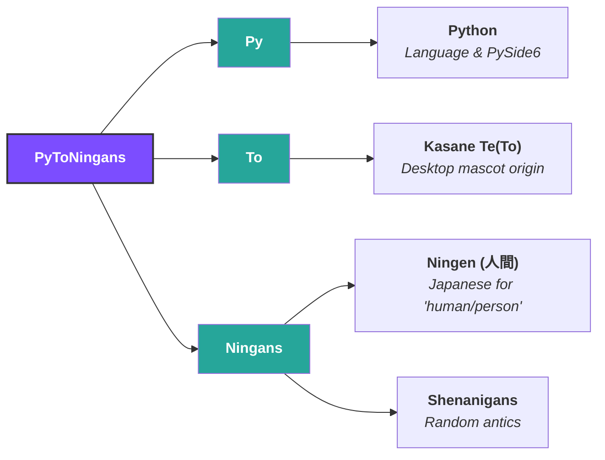

# PyToNingans

<!-- markdownlint-disable no-inline-html -->

    

    
    
    

---

> An app about putting little creatures on your desktop... Like Teto :)

That was the original premise, but now after expanding on the idea so much, it's no longer just a "Desktop Pets" app... It's uh,
something like a **Desktop Entities Engine Platform**? I'm unsure about the terminology because, well... Yeah; It has modding
capabilities built-in, a way to easily create your own entities that can roam around and interact with you desktop, and even
an _optional_ platform where users of this application can just upload their mods/modpacks they have made. It's optional, because
you don't really have to upload to _my_ database, meaning; you can just host your own!

It's all about flexibility over here, and giving people the tools to also be able to reasonably recreate,
what I have done here with this entire project so far.

> The app is still under development, so expect bugs, broken features, and inconsistencies!
> Because of this, I recommend to await for the "Teto Approval" GIF that I'll be putting in
> the [Stability Status](#stability-status) section found below.

---

## About

Initially, this app was supposed to be made with `Flutter`, but after testing its performance,
I have concluded that it would be better to try a different GUI framework, that supports
multiple window instances, that focuses more on performance. The `Flutter` version does work,
but the issue with that, is that each new window instance has their own `Flutter` engine,
which means that it's not exactly lightweight.

And that's how this app was born... After searching for some easy to setup GUI frameworks,
one of them was the `Python` version of `Qt`; `PySide6`. I have tried this before with `C++`, but
the issue with that, was I'm not that good with `C++` yet, and was also my very first
language (and GUI framework used), which dates back a couple of years ago...

Now you might ask yourself, what does `PyToNingans` mean? Well, it's literally just a
combination of puns and acronyms:

Anyway, hope you'll like this game about having desktop critters roam around! You can refer to the documentation website
in the about section of this repo to the right, or you can just go here: [PyToNingans Documentation](https://meta-dusk.github.io/pytoningans/)

---

## Stability Status

As of version **0.8.7**, I can't really say for certain, if the app is ready for the public.
But in order to keep the documentation and release history available, I'll keep the repository public, and keep on publishing
_stable_ releases in the [Releases](https://github.com/Meta-Dusk/pytoningans/releases) section of the repo.

Considering that it's just me that's developing all this, I can't really do enough extensive testing to say that the app is in
an actual _stable_ state. For now, I'll rate the current state with the following GIF:

> Will Teto ever get her baguette? No one will ever know...
> The same could be said for the state of the app. Except; I will know when the app is ever ready.
> Do please wait for news of this! :smiley:
