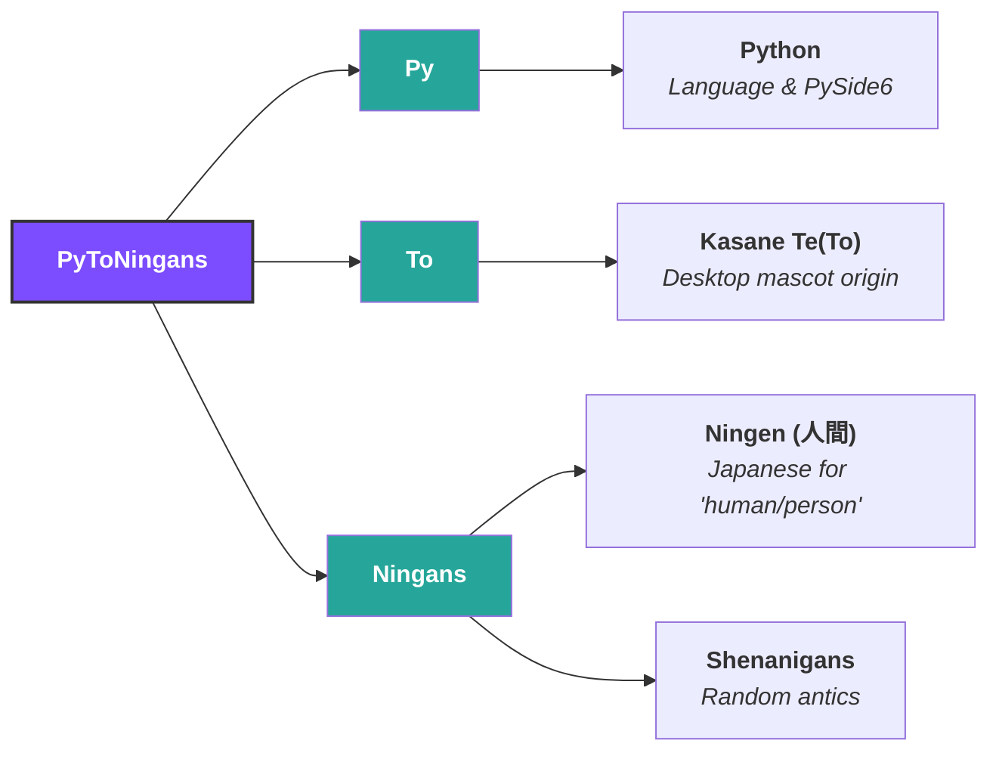

# About

> An app about putting little creatures on your desktop... Like Teto :)

That was the original premise, but now the "app" has now taken a new form! It resembles a game more, so
it's now more of an **Idler Sandbox Game**.

---

Initially, this app was supposed to be made with :simple-flutter: `Flutter`, but after testing its performance,
I have concluded that it would be better to try a different GUI framework, that supports
multiple window instances, that focuses more on performance. The :simple-flutter: `Flutter` version does work,
but the issue with that, is that each new window instance has their own :simple-flutter: `Flutter` engine,
which means that it's not exactly lightweight.

And that's how this app was born... After searching for some easy to setup GUI frameworks,
one of them was the :simple-python: `Python` version of :simple-qt: `Qt`; `PySide6`.
I have tried this before with :simple-cplusplus: `C++`, but the issue with that,
was I'm not that good with :simple-cplusplus: `C++` yet, and was also my very first
language (and GUI framework used), which dates back a couple of years ago...

Now you might ask yourself, what does `PyToNingans` mean? Well, it's literally just a
combination of puns and acronyms:

