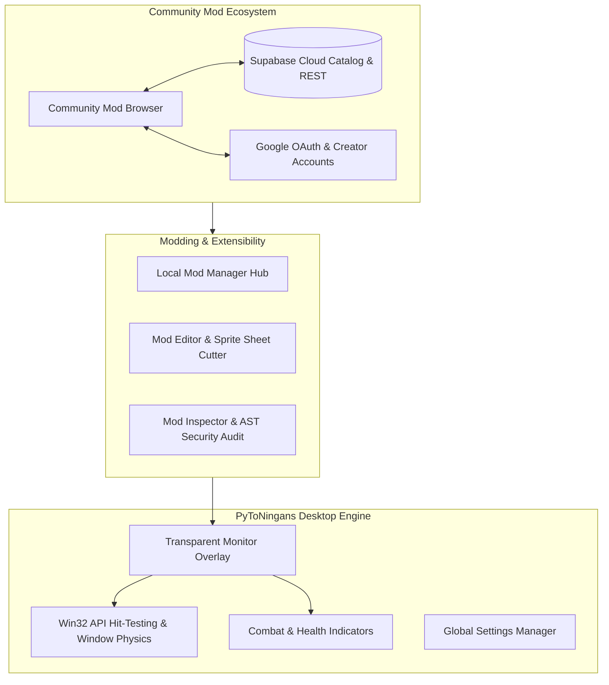

# Welcome to PyToNingans

**PyToNingans** is an extensible, offline-first desktop idler sandbox game and modding platform built with **Python 3.14+** and **PySide6 (Qt)**.

Characters and companions roam, wander, interact, and battle on your Windows desktop, naturally landing and interacting with the top boundaries of non-maximized application windows.

---

## Key Features

=== "Desktop Sandbox"
    - **Transparent Overlay**: Frameless, click-through overlay that coexists seamlessly with your daily workflow.
    - **Desktop Window Physics**: Entities walk, jump, and stand on the borders of your active desktop application windows using low-level Win32 window hit-testing.
    - **Dynamic Spawning**: Spawn individual entities, full crews, or define desktop spawn exclusion rules.

=== "Combat & Visuals"
    - **Interactive Combat**: Characters can battle and unleash animated attacks on your screen.
    - **Customizable Feedback**: Floating damage popups, proportional health bar impact shaking, numerical HP displays, and auto-hide timing.
    - **Catppuccin Themes**: Hand-crafted Dark and Light themes with consistent aesthetics.

=== "Community & Modding"
    - **Rich Modpacks**: Group multiple entities into cohesive bundles with shared controllers (`BaseModPack`) and global state.
    - **Safety First**: Integrated AST security analyzer checks imported packages for prohibited modules before execution.
    - **Offline-First Mod Browser**: Discover, install, rate, and update community mods without mandatory logins.
    - **Cloud Sync**: Optional Supabase Cloud integration with Google Sign-In and Git-like release versioning.

---

## Quick Navigation

| Topic | Documentation Guide | Description |
| :--- | :--- | :--- |
| 📥 **Setup** | [Installation & Setup](getting-started/installation.md) | Prerequisites, source cloning, and running with `uv` or Nuitka. |
| 🎮 **Controls** | [Quickstart Guide](getting-started/quickstart.md) | Spawning characters, dragging entities, and Control Panel basics. |
| 🪟 **Physics** | [Desktop Window Physics](user-guide/desktop-physics.md) | Win32 hit-testing and standing on desktop application windows. |
| ⚔️ **Combat** | [Combat & Visual Feedback](user-guide/combat-visuals.md) | Damage numbers, impact shakes, and health bar modes. |
| ⚙️ **Settings** | [Settings & Developer Tools](user-guide/settings.md) | Multi-category settings, DPI scaling, and Developer Mode. |
| 📦 **Modding** | [Mod Architecture & Config](modding/mod-structure.md) | Manifest format, animation rows, and config schemas. |
| 👥 **Modpacks** | [Modpacks & Shared Controllers](modding/creating-packs.md) | Bundling multi-entity rosters and custom `pack.py` controllers. |
| 🛡️ **Security** | [Security Audit & AST](modding/inspector-audit.md) | Automated AST safety checks and package inspection. |
| ☁️ **Publishing** | [Community Hub & Cloud](modding/publishing.md) | Supabase sync, Google Sign-In, ratings, and Git-like releases. |
| 📜 **API** | [API Reference](api/reference.md) | Auto-generated Python API documentation and docstrings. |
