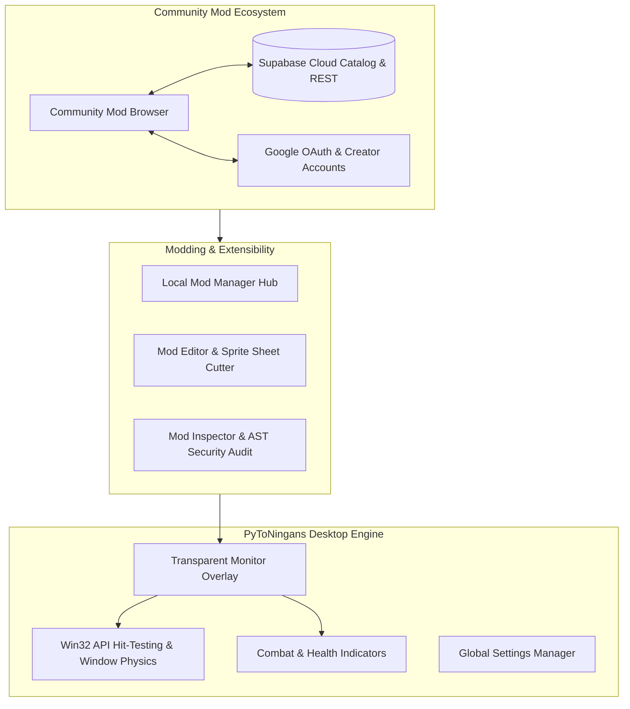

# Welcome to PyToNingans

**PyToNingans** is an extensible, offline-first desktop idler sandbox game and modding platform built with **Python 3.14+** and **PySide6 (Qt)**.

Characters and companions roam, wander, interact, and battle on your Windows desktop, naturally landing and interacting with the top boundaries of non-maximized application windows.

---

## Disclaimers

The current icon that the app uses, which is this chibi Kasane Teto character, is an asset I do NOT own.
This will be replaced in the near future however. The reason I chose this asset, is because it's cute.
That's literally just it :)

As for other stuff... Yeah, I used AI to help me develop this project, and don't worry; my stance with AI,
is that I **despise** the use of generative AI with art, which is why all of the assets used in this project,
will either be made by me, _borrowed_, or commissioned by me.

> Assets _borrowed_ are temporary, and will be replaced soon.

---

## Key Features

=== "Desktop Sandbox"
    - **Transparent Overlay**: Frameless, click-through overlay that _attempts to_ coexists seamlessly with your daily workflow. This is also known as the _World Overlay_.
    - **Desktop Window Physics**: Entities walk, jump, and stand on the borders of your active desktop application windows using low-level Win32 window hit-testing.
    - **Dynamic Spawning**: Spawn individual or multiples of entities, and even define desktop spawn exclusion rules.
    - **Entity Interactions**: Entities can be made to interact with each other, or even your OS windows as physics, or just detect the window names for dialogue triggers and such.
    - **Particle System**: Spawn particles for visual flair or make them act as projectiles, with both being able to physically interact with entities and OS windows on your desktop.

=== "Combat & Visuals"
    - **Interactive Combat**: Characters can battle and unleash animated attacks on your screen.
    - **Customizable Feedback**: Floating damage popups, proportional health bar impact shaking, numerical HP displays, and auto-hide timing.
    - **Minimalistic Themes**: I'm not that good of a UI designer, so I made it minimalistic instead.

=== "Community & Modding"
    - **Modpacks**: Group multiple entities into cohesive bundles with shared controllers (`BaseModPack`) and global state.
    - **Safety First**: Integrated AST security analyzer checks imported packages for prohibited modules before execution.
    - **Offline-First Mod Browser**: Discover, install, rate, and update community mods without mandatory logins.
    - **Upload Your Mods**: You can publish your own mods if you login with a verified sign-in provider.
    - **Cloud Sync**: Optional Supabase Cloud integration with sign-in for Google and Github, and Git-like release versioning.

---

## Quick Navigation

| Topic | Documentation Guide | Description |
| :--- | :--- | :--- |
| :material-rocket-launch-outline: **Setup** | [Installation & Setup](getting-started/installation.md) | Prerequisites, source cloning, and running with `uv` or Nuitka. |
| :material-gamepad-variant-outline: **Controls** | [Quickstart Guide](getting-started/quickstart.md) | Spawning characters, dragging entities, and Control Panel basics. |
| :material-atom: **Physics** | [Desktop Window Physics](user-guide/desktop-physics.md) | Win32 hit-testing and standing on desktop application windows. |
| :material-sword-cross: **Combat** | [Combat & Visual Feedback](user-guide/combat-visuals.md) | Damage numbers, impact shakes, and health bar modes. |
| :material-tune: **Settings** | [Settings & Developer Tools](user-guide/settings.md) | Multi-category settings, DPI scaling, and Developer Mode. |
| :material-puzzle-outline: **Modding** | [Mod Architecture & Config](modding/mod-structure.md) | Manifest format, animation rows, and config schemas. |
| :material-package-variant-closed: **Modpacks** | [Modpacks & Shared Controllers](modding/creating-packs.md) | Bundling multi-entity rosters and custom `pack.py` controllers. |
| :material-shield-check-outline: **Security** | [Security Audit & AST](modding/inspector-audit.md) | Automated AST safety checks and package inspection. |
| :material-cloud-upload-outline: **Publishing** | [Community Hub & Cloud](modding/publishing.md) | Supabase sync, Google Sign-In, ratings, and Git-like releases. |
| :material-code-braces: **API** | [API Reference](api/reference.md) | Auto-generated Python API documentation and docstrings. |
