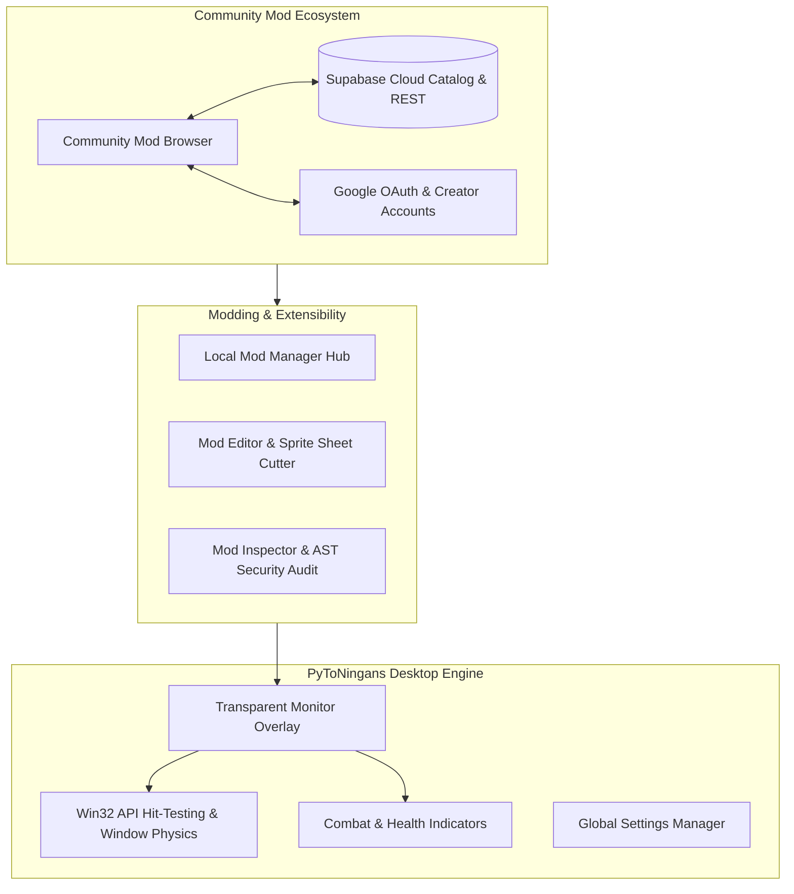

# Welcome to PyToNingans

**PyToNingans** is an extensible, offline-first desktop idler sandbox game and modding platform built with **Python 3.14+** and **PySide6 (Qt)**.

Characters and companions roam, wander, interact, and battle on your Windows desktop, naturally landing and interacting with the top boundaries of non-maximized application windows.

---

## Key Features

=== "Desktop Sandbox"
    - **Transparent Overlay**: Frameless, click-through overlay that coexists seamlessly with your daily workflow.
    - **Desktop Window Physics**: Entities walk, jump, and stand on the borders of your active desktop application windows using low-level Win32 window hit-testing.
    - **Dynamic Spawning**: Spawn individual entities, full crews, or define desktop spawn exclusion rules.

=== "Combat & Visuals"
    - **Interactive Combat**: Characters can battle and unleash animated attacks on your screen.
    - **Customizable Feedback**: Floating damage popups, proportional health bar impact shaking, numerical HP displays, and auto-hide timing.
    - **Catppuccin Themes**: Hand-crafted Dark and Light themes with consistent aesthetics.

=== "Community & Modding"
    - **Rich Modpacks**: Group multiple entities into cohesive bundles with shared controllers (`BaseModPack`) and global state.
    - **Safety First**: Integrated AST security analyzer checks imported packages for prohibited modules before execution.
    - **Offline-First Mod Browser**: Discover, install, rate, and update community mods without mandatory logins.
    - **Cloud Sync**: Optional Supabase Cloud integration with Google Sign-In and Git-like release versioning.

---

## Quick Navigation

- :material-download: **[Installation & Setup](getting-started/installation.md)**

    Get PyToNingans running on your PC in less than two minutes using `uv`.

- :material-play-circle-outline: **[Quickstart Guide](getting-started/quickstart.md)**

    Learn basic controls, spawning entities, and navigating the Control Panel.

- :material-package-variant-closed: **[Modding Guide](modding/mod-structure.md)**

    Create your own desktop companions, spritesheets, and Modpacks.

- :material-cloud-outline: **[Community Hub & Publishing](modding/publishing.md)**

    Publish and update releases on the community mod catalog with Supabase.

