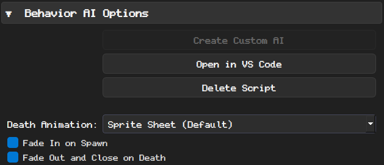

# Example Mod Behavior Scripts

First, open the :material-window-open: **Mod Editor** by clicking the
:material-button-cursor: `Manage Mods` button in the :material-window-open:**Control Panel**.

Then, you can either double-click a mod, or click the :material-button-cursor: `Edit Selected`
action button to the right. Once you have the :material-window-open: **Mod Editor** open, you
can then open the collapsible section :material-tab: `Behavior Options`
and click :material-button-cursor: `Create Custom AI` to create a starting script that you can edit.

You can then open it with the :material-button-cursor: `Open in VS Code` button.
All entities can have custom behavior, but for this example, it'll show the living entity counterpart.
For items, you'd expect an :material-tab: `Item Custom Behavior` collapsible section instead,
and the same goes for `Structures`.



---

## Starting Script

```python
from api import BaseEntityBehavior, IEntity

class Behavior(BaseEntityBehavior):
    def on_spawn(self, entity: IEntity) -> None:
        pass

    def on_update(self, entity: IEntity, dt: int) -> None:
        pass

    def on_decision_tick(self, entity: IEntity) -> bool:
        # Return True to override default engine movement/AI
        return False
```

The script at first, would contain this. There's documentation inside the scripts themselves,
and also in the :simple-github: GitHub repo, so you can just check those out.
As for the following examples I'll be showing, will be assuming that you've at least read them.

---

## Example Item Interactions

```python
from api import BaseEntityBehavior, IEntity, IItem

class MiguBehavior(BaseEntityBehavior):
    def on_item_interact(self, entity: IEntity, item: IItem) -> bool:
        if entity.held_item is not None: return False
        entity.say(
            f"φ(゜▽゜*)♪ My {item.display_name} now!",
            duration_ms=2000
        )
        item.pick_up(entity)
        return True
```

The following example above, is a simple implementation on how to make entities pick up
_any_ item they come across. The method `on_item_interact()` gets triggered if the
entity collides with an item, thus, you can simply check if the entity is already holding
an item themselves, and if not; just pick up the item.

---

## Example Mouse Cursor Interactions

```python
import math
from api import BaseEntityBehavior, IEntity

class TetoBehavior(BaseEntityBehavior):
    def __init__(self) -> None:
        super().__init__()
        self._catch_cooldown_ms: int = 0
        self._follow_cooldown_ms: int = 0
    
    def _chase_cursor(self, entity: IEntity) -> None:
        entity.say(
            "I'm going to catch you >:)", duration_ms=2000
        )
        entity.follow_cursor(min_distance=20.0)
        self._follow_cooldown_ms = 4000
    
    def on_spawn(self, entity: IEntity) -> None:
        self._chase_cursor(entity)

    def on_update(self, entity: IEntity, dt: int) -> None:
        if self._catch_cooldown_ms > 0:
            self._catch_cooldown_ms -= dt
            return

        if self._follow_cooldown_ms > 0:
            self._follow_cooldown_ms -= dt

        if self._catch_cooldown_ms <= 0 and self._follow_cooldown_ms <= 0:
            self._chase_cursor(entity)

        if entity.is_cursor_grabbed or not entity.is_following_cursor:
            return

        cx, cy = entity.get_cursor_pos()
        dist: float = math.hypot(
            cx - (entity.x() + entity.width() / 2),
            cy - (entity.y() + entity.height() / 2)
        )
        if dist < 40:
            entity.follow_cursor(False)
            entity.grab_cursor(duration_ms=3000)
            entity.say(
                "Got your cursor! >:)",
                duration_ms=2000
            )
            entity.jump()
            self._catch_cooldown_ms = 4000

    def on_cursor_released(self, entity: IEntity) -> None:
        self._follow_cooldown_ms = 4000
```

The example shown above, is for an entity that will attempt to take hold of your cursor
once it gets close enough. There's also a cooldown so that the entity also drops it
after taking the cursor, making sure to not soft-lock the user. During the cooldown,
the entity will simply use the default behavior, wherein it'll just move around as usual.
