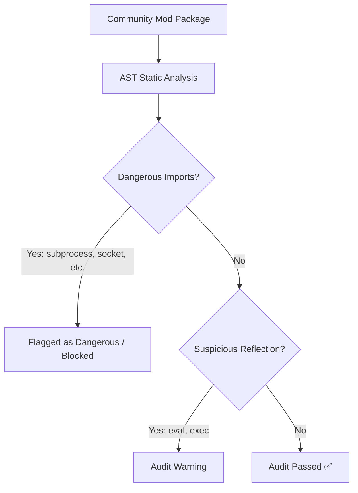

# Security Audit & AST Sandbox

Because community mods and modpacks can include Python scripts (`pack.py`), security and sandboxing are critical. PyToNingans provides an automated **AST (Abstract Syntax Tree) Security Analyzer** and visual **Mod Inspector**.

---

## The Mod Inspector

Before installing or running any mod, you can inspect it directly inside the Mod Browser by clicking the **Inspect** button:

* **File Hierarchy**: Browse package assets, sprites, audio files, and scripts before extracting.
* **Manifest Viewer**: Review configuration parameters, required engine versions, and authors.
* **Source Code Viewer**: Inspect Python script contents with syntax highlighting.
* **AST Security Audit**: Review automated safety verdicts and audit reports.

---

## AST Security Rules

The AST Security Analyzer statically parses Python code without executing it. It checks for unsafe operations and assigns one of three safety ratings:

### 1. ✅ Clean / Passed

No suspicious imports or restricted system calls detected. Safe for execution.

### 2. ⚠️ Warning

Uses dynamic attribute access (`getattr`, `eval`) or unusual reflection. Permitted, but highlighted for user review.

### 3. 🚫 Prohibited / Blocked

Attempts to import or invoke dangerous system modules:

* `subprocess`, `os.system`, `shutil.rmtree`
* Network sockets (`socket`, raw HTTP callers outside approved clients)
* Direct low-level process memory modification

