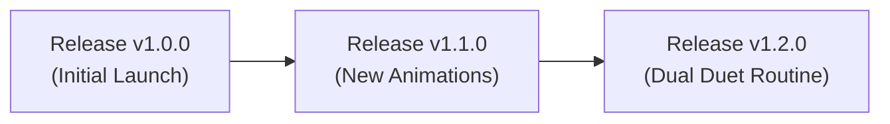

# Community Hub & Cloud Publishing

The **Community Mod Browser** connects players with creators. You can discover, install, update, rate, and publish community creations seamlessly.

---

## Offline-First Architecture

PyToNingans operates **offline-first**:

* You do not need an account or internet connection to use the app, manage local mods, or test custom companions.
* The browser launches instantly into **Offline Catalog** mode using local disk cache.
* Click **Connect to Cloud** at any time to sync live releases from the community Supabase database.
* Click **Work Offline** to immediately revert to local cache.

---

## Creator Accounts & Authentication

To publish mods or submit ratings, creators authenticate to prevent impersonation and spam uploads:

1. **Email & Password**: Standard account registration with client confirmation.
2. **Continue with Google**: Secure OAuth 2.0 login in your default browser.
3. **Continue in Offline Mode**: For offline testing, set up a local creator profile (`@LocalCreator`) without cloud credentials.

---

## Git-Like Release Management

When publishing a mod or modpack, PyToNingans manages versions like a version control system:

* **No Duplicate Uploads**: Publishing a mod with an existing ID automatically appends a new entry to that mod's `mod_releases` table.
* **Changelogs**: Each release tracks its own version notes and target compatibility (`target_app_version`, `config_version`).
* **One-Click Update**: Users with an installed older version see an **Update** button on the mod card, automatically downloading and replacing older files.
* **Rating System**: Community scores range from 1.0 to 10.0, averaged in real time.
