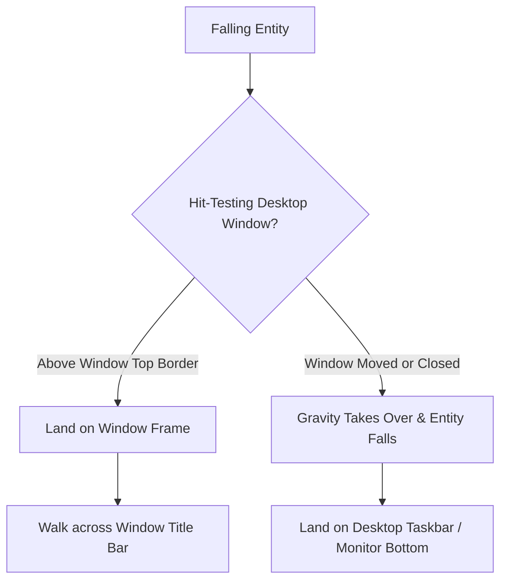

# Desktop Window Physics

One of the main features of PyToNingans is the **real-time desktop environment collision system**.
To put it simply, characters have the ability to physically interact with the windows you have open
in your desktop. This behavior is toggleable in the settings as well.

Below are some expected behaviors:

=== "Window Interactions"
    - **Entity Damage**: You can allow entities to attack windows when they collide with them, and even how they interact.
    - **The Physics**: Toggleable global setting that makes entities physically interact with windows, by blocking them, and letting them walk on them, etc.

---

## How Window Collision Works

PyToNingans interfaces directly with the native Windows desktop manager via the **Win32 API** (`user32.dll`):

1. **Window Enumeration**: The engine queries visible top-level windows on the screen (e.g., text editors, web browsers, file explorers).
2. **Hit-Testing**: The engine retrieves window rectangles (`GetWindowRect`) while filtering out minimized windows, transparent overlays, and fullscreen desktop workers.
3. **Platform Recognition**: When an entity falls onto the top edge of a window frame, the physics solver converts the window boundary into a temporary solid platform.

---

## Configuring Window Physics

You can configure physics behavior dynamically in the **Settings** dialog under the **Combat & Visuals** tab:

* **Enable Desktop Window Physics**: Check to allow characters to stand and walk on non-maximized application windows.
* **Avoid Spawning Over Open Windows** *(Spawning Tab)*: Prevents characters from appearing directly over your active work windows, prioritizing unobstructed desktop regions.
