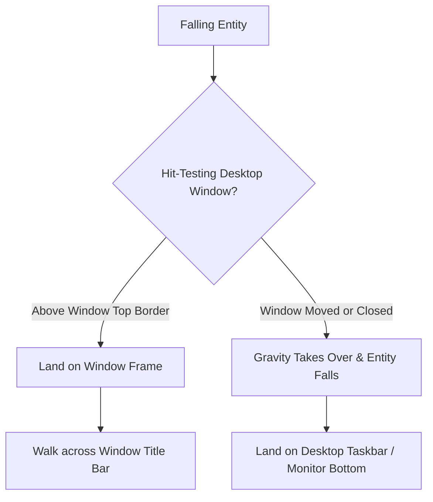

# Desktop Window Physics

One of the standout features of PyToNingans is its **real-time desktop environment collision system**. Characters do not merely walk across the bottom of your monitor—they recognize other running desktop applications as physical obstacles and platforms.

---

## How Window Collision Works

PyToNingans interfaces directly with the native Windows desktop manager via the **Win32 API** (`user32.dll`):

1. **Window Enumeration**: The engine queries visible top-level windows on the screen (e.g., text editors, web browsers, file explorers).
2. **Hit-Testing**: The engine retrieves window rectangles (`GetWindowRect`) while filtering out minimized windows, transparent overlays, and fullscreen desktop workers.
3. **Platform Recognition**: When an entity falls onto the top edge of a window frame, the physics solver converts the window boundary into a temporary solid platform.

---

## Configuring Window Physics

You can configure physics behavior dynamically in the **Settings** dialog under the **Combat & Visuals** tab:

* **Enable Desktop Window Physics**: Check to allow characters to stand and walk on non-maximized application windows.
* **Avoid Spawning Over Open Windows** *(Spawning Tab)*: Prevents characters from appearing directly over your active work windows, prioritizing unobstructed desktop regions.
